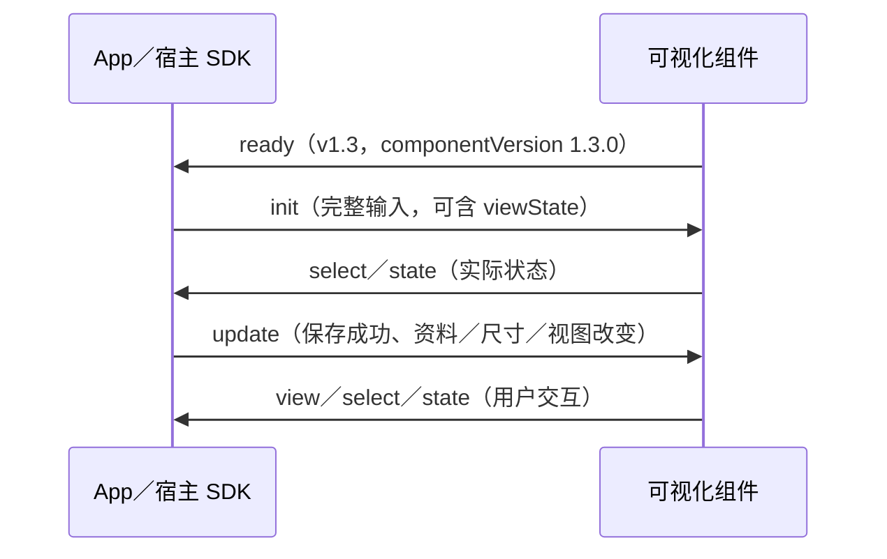

# MVP-v1.3 API 说明

- 产品版本：`MVP-v1.3`；App 与可视化组件的 API 版本：`v1.3`。
- 组件构建版本：`1.3.0`；本轮实现／验证更新日期：2026-10-13（Asia/Shanghai）。
- 适用组件：`height`、`weight`、`bowel`。
- 对应需求：[MVP-v1.3-需求规格.md](MVP-v1.3-需求规格.md)。
- 唯一共享类型和运行时校验源：`packages/visualization-api/src/index.ts`。

本文明确整合 App 与三个原可视化组件之间的实际工程契约。原需求文档 §4 已描述职责、建议字段和事件，**部分覆盖 API**，但缺少足以独立接入的 schema、状态、生命周期、校验、错误、安全和构建规则，故单独提供与 MVP 同号的本文。工程细节是本版实现约定，不改变原需求的确认状态。

## 1. 工程边界与版本

| 部分 | 源码位置 | 职责 |
|---|---|---|
| 整合 App | `src/App.tsx`、`src/lib/` | 页面与九宫格布局、下钻占位、模块开关、列表、孩子资料、记录增删改、数据保存与可视化有效记录筛选 |
| 共享契约 | `packages/visualization-api/src/index.ts` | API 类型、封套、输入与状态校验、消息构造、当地时间绘图坐标工具；不导入 App 或组件内部实现 |
| 宿主 React SDK | `packages/visualization-host-react/src/VisualizationFrame.tsx` | iframe 加载、来源检查、握手、尺寸与数据发送、状态回传、错误与重试；App 通过 SDK 接入 |
| 身高组件 | `packages/height/src/` | 复用原身高图、WHO 参照、内部浏览与选点；通过共享 API 接收输入和回传事件 |
| 体重组件 | `packages/weight/src/` | 复用原体重图、日期轴、游标、内部浏览与选点；通过共享 API 接入 |
| 排便组件 | `packages/bowel/src/` | 复用原排便日历、glyph、图例、当地时间显示、连续六周浏览；通过共享 API 接入 |

App 不导入组件内部绘图代码，组件不导入 App 的数据保存、界面或业务模块。组件只接收数据快照，不承担新增、修改、删除和服务器持久化；用户下钻请求由 App 决定整体布局。

`src/types.ts` 直接引用共享契约的 `ComponentId`、`Profile`、`View` 和 `VisualizationRecord`，仅扩展 App 的体脂率／饮食和备注字段，不重复维护另一份可视化字段定义。`src/components/VisualizationFrame.tsx` 只是兼容导出路径，宿主实现统一位于 SDK 包中。组件维护入口是原 HTML 图表资产及可读适配层；本轮没有重建原身高绘图、WHO 数据或体重 LOWESS 算法。

`apiVersion` 必须精确为 `v1.3`，旧版缺少版本或使用 `v1.2` 的消息不能静默接入。三个组件的 `ready.componentVersion` 必须为本版固定构建版本 `1.3.0`。既有独立设计文档正文版本保持身高 v0.4、体重 v0.5、排便 v0.4；身高与排便文件名保留上传时的 v0.3。设计版本与 API 版本分别登记。

## 2. 传输与消息封套

通信使用 `iframe + window.postMessage`。每条消息均为对象，使用以下封套，不将 `view` 或错误字段放到封套顶层：

```ts
interface VisualizationEnvelope<T = unknown> {
  channel: 'growlog';
  apiVersion: 'v1.3';
  component: 'height' | 'weight' | 'bowel';
  action: 'init' | 'update' | 'ready' | 'view' | 'select' | 'state' | 'error';
  payload: T;
  requestId?: string;
}
```

`requestId` 是可选的追踪 ID，非空且最多 200 字符。相关输入错误可以回传它；用户交互事件不必关联某次输入。它不表示请求已保存，也不构成 HTTP 事务 ACK。未知字段允许存在，校验器忽略它们，不修改输入对象或转写日期／时区；已知字段必须符合本版规则。

| 方向 | `action` | `payload` | 行为 |
|---|---|---|---|
| App → 组件 | `init` | `VisualizationInput<C>` | 首次有效输入；可含需要恢复的组件浏览状态 |
| App → 组件 | `update` | `VisualizationInput<C>` | 完整输入快照；更新数据、资料、当前日期时间、视图和尺寸，按状态规则保持浏览 |
| 组件 → App | `ready` | `{ componentVersion: '1.3.0', supportedActions: ['init', 'update'] }` | 组件已安装消息接收器；宿主验证后发送 `init`。两个 action 各出现一次 |
| 组件 → App | `view` | `{ view: 'overview' \| 'detail' }` | 请求概览／下钻；宿主更新外层布局，再发送实际占位和视图 |
| 组件 → App | `select` | `{ recordId: string \| null }` | 身高／体重回传当前选点；空记录时为 `null`。选点不新增或保存记录 |
| 组件 → App | `state` | `{ view, viewState: ViewStateByComponent[C] }` | 回传可恢复状态；宿主按组件分别保存，用于列表往返和重新挂载 |
| 组件 → App | `error` | `{ code, message, recoverable, requestId? }` | 版本、输入或生命周期错误；错误码和处理见 §7 |

组件不会用 `update` 作为输出，App 不用 `state` 作为输入。`validateEnvelope` 可以按方向及目标组件严格检查。

排便沿用点击切换概览／下钻的原交互，当前输出 `ready`、`view`、`state` 和 `error`；不增加点击选择某条排便记录的交互，也不新增 `select` 输出。其可恢复状态仅包含周起点。

## 3. App → 组件完整输入

```ts
interface VisualizationInput<C extends ComponentId> {
  records: VisualizationRecord[];
  profile: { name?: string; birthDate: string; sex: 'male' | 'female' };
  today: string;
  nowLocalTime: string;
  view: 'overview' | 'detail';
  width: number;
  height: number;
  viewState?: ViewStateByComponent[C];
}

interface VisualizationRecord {
  id: string;
  type: 'height' | 'weight' | 'bowel';
  localDate: string;
  localTime: string;
  timeZone: string;
  value?: number;
  measurementMethod?: 'standing';
}
```

除了 `name`、`viewState` 以及按记录类型区分的可选字段，其余字段必填。`init` 和 `update` 使用相同完整结构；`update` 不接受仅包含变更字段的 patch。

| 字段 | 类型与单位 | 校验／语义 |
|---|---|---|
| `records` | 数组 | 0–10000 条；空数组进入组件空状态。仅发送对应组件的可视化有效记录 |
| `records[].id` | string | 去除空白后非空、总长度 ≤200；同一快照中唯一且稳定。修改记录保留 ID |
| `records[].type` | 组件标识 | 必须与封套 `component` 一致；不能将身高与体重混传 |
| `records[].localDate` | `YYYY-MM-DD` | 真实日期，年份 0001–9999；不得早于 `profile.birthDate` |
| `records[].localTime` | `HH:mm:ss` | 24 小时制，秒必填；保留发生时原始当地时间 |
| `records[].timeZone` | string | 浏览器 `Intl` 可识别的 IANA 时区标识，例如 `Asia/Shanghai`、`UTC`；不接收 `+08:00` 等 offset 字符串 |
| `records[].value`（身高） | number，cm | 有限数，30–250；必填。这是原型输入范围，不是医学阈值 |
| `records[].value`（体重） | number，kg | 有限数，3–200；必填。这是原型输入范围，不是医学阈值 |
| `records[].value`（排便） | 不传 | 排便按日期与时间表达；同一原始当地日期最多一条，App 保存阶段完成同日覆盖 |
| `records[].measurementMethod` | `'standing'`，可选 | 仅身高可传；不传按原站立身高规则解释。本版公共 API 不接收其他值 |
| `profile.name` | string，可选 | 最多 200 字符，仅为组件输入信息；App 自身保存时昵称校验另见附录 |
| `profile.birthDate` | `YYYY-MM-DD` | 真实日期且不晚于 `today` |
| `profile.sex` | `'male' \| 'female'` | 必填，用于适用的 WHO 参照 |
| `today` | `YYYY-MM-DD` | 查看设备当前当地日期，真实日期 |
| `nowLocalTime` | `HH:mm:ss` | 查看设备当前当地时间，秒必填，用于无体重记录等初始化 |
| `view` | `'overview' \| 'detail'` | 宿主实际分配的视图；组件不通过它自行占据 App 其他格子 |
| `width`、`height` | number，CSS px | 实际容器尺寸；有限数，均在 `(0, 10000]`；不是设备物理像素 |
| `viewState` | 组件专属对象，可选 | 显式恢复命令。省略时保持组件当前有效浏览状态；结构见 §4 |

出生日期前的记录仍由 App 保存并可在列表查看，进入组件前由 App 筛掉；组件校验器同时拒绝未筛除的记录，不默默删除它们。公共可视化 API 不增加“记录不能晚于今天”的限制；App 记录管理按既有需求处理。模块关闭也不删除原始数据。

`localDate`、`localTime` 和 `timeZone` 原样传输，图和列表展示原始当地发生时间，不按查看设备时区转换。共享工具使用 UTC 计算方法得到稳定的数值绘图坐标，仅表达这些当地字段的位置，不能将该数值当作真实 UTC 时刻。范围状态使用不带 `Z` 或 offset 的当地时间字符串。

## 4. 组件专属浏览状态

```ts
interface TimeRange { startLocal: string; endLocal: string }
interface HeightViewState {
  selectedRecordId: string | null;
  heightRange: { minCm: number; maxCm: number };
  timeRange: TimeRange;
}
interface WeightViewState {
  selectedRecordId: string | null;
  timeRange: TimeRange;
}
interface BowelViewState { startDate: string }
interface ViewStateByComponent {
  height: HeightViewState;
  weight: WeightViewState;
  bowel: BowelViewState;
}
```

| 状态字段 | 校验和恢复规则 |
|---|---|
| 身高／体重 `selectedRecordId` | 非空 ≤200 字符的 ID 或 `null`；允许接入时是已删除／被出生日期过滤的旧 ID，由组件按原选点规则重映射 |
| 身高 `heightRange` | cm，有限数且 `0 ≤ minCm < maxCm ≤ 250`；最终显示仍须服从原图的有效范围与缩放边界 |
| 身高／体重 `timeRange` | 真实当地 `YYYY-MM-DDTHH:mm:ss` 或 `YYYY-MM-DDTHH:mm:ss.SSS`，不带时区后缀；`startLocal < endLocal`。组件输出统一带三位毫秒 |
| 排便 `startDate` | 真实 `YYYY-MM-DD` 且必须是周一；表示连续六周视窗起点，不能恢复为半周 |

输入合法只表示结构通过校验，不承诺按数值原封不动显示。组件会按其设计边界归一化；以之后回传的 `state` 为实际显示状态。身高沿用 0–250 cm、至少 15 cm 的可视高度范围。

身高首次初始化仍使用原图的数据时间范围；本次组件挂载的浏览边界覆盖历次有效数据的默认时间范围及显式恢复的有效时间范围，累计扩展，不因删除最早记录、资料过滤或空数据而缩小并重置当前时间轴。恢复、缩放和平移仍沿用原边界算法，最小可见时间跨度为该浏览边界跨度的 1/40。重载后的边界可以由当前数据和恢复状态建立，使缺少已删记录时仍能恢复原可视时间范围；实际结果经 `state` 回传。

体重首次有记录时以最新有效记录为中心，按原规格显示前后各四个日历月；月末不足天数按日历月规则截尾。无记录时以 `today + nowLocalTime` 为中心。合法的显式体重时间范围完整恢复，不按全部记录日期裁切；后续删除至空数组仍保留已有浏览时间范围，选点改为 `null`，原用户缩放边界保持。排便视窗始终为六周（42 天）：最晚起点为查看设备当前周周一减 28 天，最早起点为首条有效记录所在周周一与最晚起点的较早者；恢复越界起点按整周钳制。无记录时起点固定为上述最晚起点。

更新有三种不同含义：

1. **显式传入 `viewState`：**以它恢复选点和范围；遇到删点、出生日期筛选或浏览边界变化时，组件先应用既有有效性规则，再回传实际状态。
2. **`update` 省略 `viewState`：**保留正在浏览的有效选点和范围；数据、资料或尺寸更新不无故重置滚动、平移或缩放。
3. **首次 `init` 省略 `viewState`：**使用原组件初始规则，包括最新有效记录、体重日历月范围和排便当前周计算。

身高／体重有记录时，`null` 或失效 ID 按原图规则落到最新有效记录；空数组时选点为 `null`。`null` 不提供“有数据时强制取消选点”的新增交互。选中记录删除后选择最新剩余记录；不应继续回传已删除的 ID。浏览范围超出当前允许范围时按组件边界归一化，不将整个图无条件重置为初始视图。

App 分组件保存最近的 `{ view, viewState }`；切换到列表时保留，重新显示图表时通过 `init` 恢复。如果组件仍已挂载，只发送普通 `update`，避免把过时快照反复写回并覆盖用户正在进行的手势。

## 5. 生命周期与更新



宿主在 iframe 加载前安装接收器，验证 `ready` 后再发送 `init`；仅 `load` 事件不代表组件就绪。组件在第一份有效 `init` 前拒绝 `update`，返回 `NOT_INITIALIZED`。**`init` 可重复：首次初始化后，有效 `init` 按 `update` 处理，省略 `viewState` 保持当前浏览，显式传入则恢复；不因重复初始化而重置图。**校验失败不替换已有有效图和状态。

记录／资料先由 App 保存，成功后才发送完整 `update`。组件收到数据不是服务端保存成功的证明；保存失败时由 App 保留错误并处理，组件不越过 App 自行写入存储。尺寸通过容器测量和 `ResizeObserver` 更新；列表／隐藏容器的 0 px 尺寸不会作为合法图表尺寸发送。

宿主等待 `ready` 最多 10 秒，超时显示宿主错误和重试入口。重试重新加载 iframe、重新握手，并使用保存的组件状态；超时不是共享 wire `error` 的新增错误码。组件已就绪后的 `update` 不需要重新握手。

组件回传其实际状态，完全相同的重复状态可以去重。回传 `view` 请求后，外层布局、概览占位和下钻容器尺寸由 App 更新。卸载时宿主移除消息接收器、停止尺寸观察和定时器；组件也清理自身接收器。不同组件状态互不覆盖。

## 6. 来源检查和不透明 origin

封套校验不检查浏览器 `MessageEvent` 的来源；调用者必须先检查：

- App 接收：`event.source === 目标 iframe.contentWindow`，并且 `event.origin === 当前宿主 origin`。
- 组件接收：`event.source === window.parent`，并且 `event.origin === 当前组件 origin`。
- 来源符合后，再检查 channel、component、方向、版本与 payload。无关 channel 或其他浏览上下文的消息忽略，不对它们广播错误。组件接收器也忽略发给其他组件的消息；SDK 对自己 iframe 发来的 `growlog` 消息做完整目标校验，目标不匹配报告本地 `INVALID_MESSAGE`。

当前发布与组件路径采用同 origin；不提供任意第三方跨 origin 组件接入。正常 HTTP／HTTPS 及继承 origin 的 Blob iframe 发送时使用明确 `targetOrigin`。本机单文件 `file:` demo 的 origin 可能为字符串 `"null"`；仅这种不透明 origin 发送时使用 `"*"`，接收端仍同时锁定准确的 parent／iframe `source` 和 `"null"` origin。不得把所有来源放宽为 `"*"` 接收，也不能只依赖 channel。

## 7. 错误与版本兼容

```ts
interface ApiError {
  code: 'UNSUPPORTED_API_VERSION' | 'INVALID_MESSAGE' | 'INVALID_PAYLOAD'
      | 'NOT_INITIALIZED' | 'LOAD_FAILED';
  message: string;
  recoverable: boolean;
  requestId?: string;
}
```

| 错误码 | 条件 | 恢复方式 |
|---|---|---|
| `UNSUPPORTED_API_VERSION` | 明确版本值不为 `v1.3` | 使用同版 App、SDK、组件重新接入；不自动降级旧消息 |
| `INVALID_MESSAGE` | 封套／方向／目标／requestId 无效；版本字段缺失等 | 修正消息封套；保留上一份有效图 |
| `INVALID_PAYLOAD` | 输入、记录、状态或事件 payload 校验失败 | 修正数据后重新发送；不采用部分无效记录 |
| `NOT_INITIALIZED` | 有效 `init` 前发送 `update` | 按 `ready → init` 重新发送 |
| `LOAD_FAILED` | 契约允许报告的组件加载／运行失败 | 由宿主显示并允许适用的重试；未收到 `ready` 的 iframe 由 SDK 本地 `READY_TIMEOUT` 处理，不能当作成功状态 |

`message` 非空、最多 2048 字符；`recoverable` 是 boolean。共享校验器自身返回的错误使用 `recoverable: true`，表示输入可修正；不表示错误输入已应用。SDK 的 iframe 加载、就绪超时和宿主自身错误可使用本地错误状态，不冒充 wire `error` 事件。

对于来源有效、目标正确的旧版请求，组件用本版错误封套报告版本不兼容；旧版消息不会修改图表。未提供版本不是合法的 v1.3 消息。版本匹配后仍校验字段及组件构建版本，不仅检查版本字符串。

## 8. 公共函数与接入示例

共享包对 TypeScript 宿主公开以下函数；浏览器组件加载构建产物后通过 `window.GrowlogVisualizationApi` 使用同一实现：

| 函数 | 返回值／作用 |
|---|---|
| `createEnvelope(component, action, payload, requestId?)` | 按本版常量构造消息，不代替输入校验 |
| `validateEnvelope(value, { component?, direction? })` | 校验完整封套与 action 对应 payload；方向为 `host-to-component` 或 `component-to-host` |
| `validateInput(component, value)` | 校验完整输入 |
| `validateViewState(component, value)` | 校验组件专属状态结构 |
| `isLocalDate(value)`、`isLocalTime(value)`、`isTimeZone(value)` | 当地日期、时间和时区校验 |
| `localDateTimeToCoordinate(local)` | 当地时间字符串 → 稳定绘图数值；无效输入为 `NaN`，不做查看时区转换 |
| `coordinateToLocalDateTime(coordinate)` | 绘图数值 → `YYYY-MM-DDTHH:mm:ss.SSS`；非有限值或超出年份范围抛 `RangeError` |

校验函数统一返回 `{ ok: true, value }` 或 `{ ok: false, error: ApiError }`，不抛出正常输入校验错误、不修改传入对象。共享校验器是纯数据契约，生命周期是否已初始化由宿主／组件维护。

### 8.1 React 宿主 SDK

`packages/visualization-host-react/src/VisualizationFrame.tsx` 的默认导出是 `VisualizationFrame`，包元数据名为 `@growlog/visualization-host-react`，构建版本 `1.3.0`。本版在同仓库通过源码入口接入，没有宣称已发布 npm 包。SDK 只导入共享契约；App 通过 Props 和回调使用它，不直接操作原图内部状态。

一个 SDK 实例对应固定指标；切换不同 `component` 时使用对应 React `key` 重新挂载，并按指标分别缓存／传入状态。本版不提供跨指标的状态转换。完整 App 为三个指标使用各自独立实例。

| Prop | 必填 | 含义 |
|---|---|---|
| `component` | 是 | `height`／`weight`／`bowel` |
| `componentUrl` | 是 | 同 origin 的组件构建入口，或独立 demo 创建的 Blob URL |
| `records`、`profile`、`today`、`nowLocalTime`、`view` | 是 | 与 §3 完全一致；App 负责准备已筛选的有效记录 |
| `initialViewState` | 否 | 初次握手的恢复状态；同一已挂载实例后续恢复用下列 ref 方法，不反复修改初始值 |
| `readyTimeoutMs` | 否 | 就绪等待时限，默认 10000 ms |
| `title` | 否 | iframe 无障碍标题，默认使用对应指标名称 |
| `onViewChange(view)` | 是 | 处理组件下钻／返回请求，App 改变外层布局和 `view` |
| `onRecordSelect(id)` | 否 | 身高／体重当前选择；`null` 表示空记录状态 |
| `onStateChange(state, view)` | 否 | 获取组件专属状态和视图，按组件保存用于重挂载恢复 |
| `onReady(payload)` | 否 | 获取已验证的组件构建版本与支持操作；之后由 SDK 发送 `init` |
| `onError(error)` | 否 | 获取共享 API 错误或本地 `READY_TIMEOUT`，SDK 同时显示重新加载入口 |

`ref` 暴露 `VisualizationHandle`：

- `restoreViewState(state): boolean`：先校验并缓存组件专属状态；已就绪且容器有尺寸时发送含 `viewState` 的完整输入，未就绪或容器为 0 px 时接受并排队，待实际容器有尺寸后发送。有效请求已接受排队或已发送返回 `true`；状态校验失败或即时完整输入发送失败返回 `false`。`true` 不是组件完成恢复或服务端保存的 ACK；实际状态以后续 `onStateChange` 为准。
- `restart(): void`：重建 iframe、重新等待 `ready`，以最近状态重新 `init`。SDK 内置“重新加载组件”按钮调用同一方法。

容器尺寸由 SDK 测量，无需 App 向 Props 传 `width`／`height`。父元素必须提供实际宽高；容器为 0 px 时 SDK 暂缓发送，尺寸恢复后再初始化／更新。显式恢复请求在真正发出前持续排队，期间旧组件状态回传不覆盖 SDK 缓存的待恢复状态；数据或尺寸更新触发发送时仍携带该请求。普通数据和尺寸更新不重复发送已完成发送的缓存 `viewState`，防止撤销用户正在进行的浏览操作。SDK 在布局阶段安装消息接收器，避免首次 `ready` 竞态；生成 `<component>-<generation>-<sequence>` 形式的 `requestId`，仅用于追踪。

```tsx
// 示例宿主文件位于仓库 src/ 内。
import VisualizationFrame from '../packages/visualization-host-react/src/VisualizationFrame';

<VisualizationFrame
  component="weight"
  componentUrl="/components/weight.html"
  records={visibleWeightRecords}
  profile={profile}
  today={deviceLocalDate}
  nowLocalTime={deviceLocalTime}
  view={weightView}
  initialViewState={savedWeightState}
  onViewChange={setWeightView}
  onStateChange={(state, view) => saveBrowseState('weight', state, view)}
  onError={showComponentError}
/>
```

示例中的 `visibleWeightRecords`、日期时间、状态和回调由宿主提供；`saveBrowseState` 保存图表浏览状态，不能代替 App 数据的 HTTP 保存。完整 App 使用 React SDK；独立组件 demo 使用 `packages/component-demo/src/main.ts` 的纯 DOM 宿主，直接调用同一共享 API，无须依赖 React SDK 或 App 内部模块。测试数据由 `packages/component-demo/src/fixtures.ts` 独立生成，页面明确标记虚构资料与记录，不读取或保存 App 数据。

### 8.2 原始消息示例

下面是一条有效身高初始化消息；真实宿主应等待已验证的 `ready`，从实际容器测得尺寸，并先筛除出生日期前的记录：

```json
{
  "channel": "growlog",
  "apiVersion": "v1.3",
  "component": "height",
  "action": "init",
  "requestId": "height-init-1",
  "payload": {
    "records": [{
      "id": "height-1", "type": "height", "value": 118.6,
      "localDate": "2026-10-10", "localTime": "08:30:00",
      "timeZone": "Asia/Shanghai", "measurementMethod": "standing"
    }],
    "profile": { "name": "测试孩子", "birthDate": "2020-08-12", "sex": "female" },
    "today": "2026-10-12", "nowLocalTime": "09:00:00",
    "view": "overview", "width": 280, "height": 480
  }
}
```

恢复身高状态时可在 `payload` 中增加：

```json
{
  "viewState": {
    "selectedRecordId": "height-1",
    "heightRange": { "minCm": 100, "maxCm": 130 },
    "timeRange": {
      "startLocal": "2026-09-01T00:00:00.000",
      "endLocal": "2026-11-01T00:00:00.000"
    }
  }
}
```

该范围仍由原图归一化；示例 ID、日期、尺寸和数据均为演示值。

## 9. 构建、独立 demo 和验证

浏览器共享运行时由 `scripts/build-api.mjs` 生成 classic IIFE：`public/components/visualization-api.js`，global 为 `GrowlogVisualizationApi`。组件从各自 `packages/<component>/src/` 构建到 `public/components/`，整合构建引用这些明确的构建产物。生成目录不是第二份手工维护源码，避免先改 public 再复制回组件。

仓库根目录执行以下命令；需要 Node.js 22 或以上，并先通过锁文件安装依赖：

```sh
npm ci
npm run build:api
npm run build:component -- height
npm run build:component -- weight
npm run build:component -- bowel
npm run build:components
npm run build
npm run build:demo
```

`build:component` 可只构建选定组件，统一构建会生成共享 API、组件资产、独立 demo 和 `public/components/manifest.json`。manifest 登记 API `v1.3`、组件构建 `1.3.0`、原设计规格版本、资产路径及 SHA256；脚本核对包、共享运行时与构建版本一致。`public/` 是生成输出，实际修改应在 `packages/` 源码进行，再重复构建，避免手工复制图表代码。

`npm run dev` 的 `predev` 自动构建组件；普通开发入口 `/` 保留服务端 `/api/state`，组件独立入口为 `/component-demos/height.html`、`/component-demos/weight.html`、`/component-demos/bowel.html`。`npm run build` 生成带服务端模式的前端产物；通过 `npm run preview` 验证，其保存 API 仍由现有中间件提供。

`npm run build:demo` 在 `dist/` 生成以下独立文件，图表及运行时内嵌，无需下载源码备份：

| 文件 | 内容 |
|---|---|
| `app-v1.3.html` | 完整 App 单文件 demo；组件通过内嵌资产创建 Blob iframe |
| `height-demo-v1.3.html` | 身高组件独立 demo；虚构数据、概览／下钻、空数据、重载恢复和 API 消息检查 |
| `weight-demo-v1.3.html` | 体重组件独立 demo；与 App 无数据／实现依赖 |
| `bowel-demo-v1.3.html` | 排便组件独立 demo；与 App 无数据／实现依赖 |
| `api-v1.3.html` | 由本文生成的在线 API 说明页，含上述 demo 入口 |
| `MVP-v1.3-API说明.md`、`MVP-v1.3-需求规格.md` | 与 MVP 同号的说明原文 |

单文件 App demo 的浏览器本机存储不改变普通服务端模式的 `/api/state` 保存路径。手机端组件不显示的问题继续暂缓，桌面 Chromium 窄视口的回归不表示手机问题已解决。

可重复执行的验证入口：

```sh
npm test
npm run test:api
npm run test:component -- height
npm run test:component -- weight
npm run test:component -- bowel
npm run test:components
npm run test:e2e
npm run test:demo
```

组件测试直接启动组件源码的独立 fixture，不启动完整 App；`test:e2e` 启动独立服务与临时存储，`test:demo` 检查已构建的单文件产物。浏览器检查使用桌面 Chromium，不将它记为手机实机验收。

2026-10-13 已核对的实际验证证据如下：

| 检查 | 当前结果 | 范围 |
|---|---|---|
| `npm test` | 23 项通过 | 服务端 10 项及共享 API 13 项；包括长版本输入的错误响应自身仍满足 schema |
| `npm run test:api` | 13 项通过 | 共享类型与浏览器运行时、版本／方向、字段、当地时间、状态校验 |
| `node --test packages/height/test.mjs` | 3 项 Chromium 测试通过 | 原身高组件的接口、状态恢复、手势与错误、重载；新增删除最早记录后保持时间范围及后续缩放的回归 |
| `node --test packages/bowel/test.mjs` | 8 项 Chromium 测试通过 | 原排便组件的 42 格日历、整周恢复与钳制、来源、错误、更新 |
| `node --test packages/weight/test.mjs` | 6 项 Chromium 测试通过 | 原体重图、状态恢复、日历月初始范围、缩放平移、事件与错误；使用仓库内可复用入口 |
| 本文两条 JSON 消息示例 | 2 条通过 | 用 `public/components/visualization-api.js` 的 `validateEnvelope` 实际校验 |
| `npm run build`、`npm run build:demo` | 通过 | 类型检查、统一组件／App 构建、四个单文件 demo 与 API 说明产物已生成 |
| `npm run test:demo` | 4 项通过 | 四个单文件页面实际运行，无外部资产或 `/api/state` 请求，组件状态与独立 demo 控件有效 |
| `npm run test:e2e` | 29 项通过，exit 0；0 失败、0 跳过 | 既有 App 14 项及新增 API 整合 15 项；包含身高删数据后范围保持与真实新 iframe 状态恢复、来源拒绝、SDK 与列表往返，以及 0 px 容器显式恢复排队后有尺寸时实际发送／恢复 |
| TypeScript 构建检查 | exit 0 | App、宿主与共享契约；新增 API 回归文件也通过独立严格类型检查 |
| 已发布 HTTPS 页面 | 5 项实际浏览器验证通过 | 整合 App 的记录增删改与刷新保存、三个独立组件的交互／空状态／重载恢复、API 文档与导航；无未捕获脚本异常 |
| 发布文件一致性 | 7 个文件 HTTP 200，SHA256 与本机构建一致 | 四个单文件 demo、API HTML 及两份 v1.3 Markdown |

以下入口已于 2026-10-13 发布至 GitHub Pages，并完成 HTTP、文件一致性及实际 HTTPS 浏览器验证：

| 入口 | 在线链接 |
|---|---|
| 整合 App | [app-v1.3.html](https://tiemeng2000.github.io/growlog/app-v1.3.html) |
| 身高独立 demo | [height-demo-v1.3.html](https://tiemeng2000.github.io/growlog/height-demo-v1.3.html) |
| 体重独立 demo | [weight-demo-v1.3.html](https://tiemeng2000.github.io/growlog/weight-demo-v1.3.html) |
| 排便独立 demo | [bowel-demo-v1.3.html](https://tiemeng2000.github.io/growlog/bowel-demo-v1.3.html) |
| API 说明 | [api-v1.3.html](https://tiemeng2000.github.io/growlog/api-v1.3.html) |

本地构建、单文件浏览器验证、正式线上发布和生产云数据服务是不同结果；本轮只将实际完成的检查标记为通过。

新增 SDK 回归使用 `e2e/fixtures/sdk-host.html`／`sdk-host.tsx` 的真实公开 SDK 宿主，不依赖 App 业务模块：验证容器隐藏为 0 px 时 `restoreViewState` 返回 `true` 并排队，普通 Props 更新不丢失请求，重新显示后实际状态和图形范围恢复，之后用户手势和普通更新不重复重放旧状态。

## 附录 A. App 数据保存 HTTP API

本附录记录原有 App → 服务端接口，**不属于 iframe 组件 API**。组件 `state` 表示浏览状态，不是下列 `AppState`，组件 `select`／`state` 也不表示保存成功。

| 方法与路径 | 输入 | 成功响应 | 用途 |
|---|---|---|---|
| `GET /api/state` | 无 | `{ state: AppState, revision: number }` | 读取服务端保存的孩子资料、模块设置和完整记录 |
| `PUT /api/state` | JSON `{ state: AppState, revision: number, today?: string }` | `{ state: AppState, revision: 旧revision+1 }` | 校验并原子保存完整 App 状态；`revision` 必须与当前版本一致 |

```ts
interface AppState {
  profile: { name: string; birthDate: string; sex: 'male' | 'female' };
  modules: Record<'height' | 'weight' | 'fat' | 'bowel' | 'diet', boolean>;
  records: Array<{
    id: string; type: 'height' | 'weight' | 'fat' | 'bowel' | 'diet';
    localDate: string; localTime: string; timeZone: string;
    value?: number; note?: string; measurementMethod?: 'standing';
  }>;
}
```

服务端记录最多 10000 条；昵称必填且最多 80 字符，备注可选且最多 10000 字符。身高、体重输入范围与组件一致，体脂率 0–75%；排便／饮食不传 `value`。服务端保存仍保留出生日期之前的记录，App 只在可视化输入处筛除。`today` 由查看设备提供，未传时使用服务端当地日期；不依据记录时区推算当前设备日期。

HTTP 请求体上限 2 MiB；响应为 JSON，设置 `Cache-Control: no-store`。错误格式 `{ error: string, code: string }`：校验为 422／`VALIDATION_ERROR`，过时 revision 为 409／`REVISION_CONFLICT`，超过请求容量为 413／`PAYLOAD_TOO_LARGE`，不合法 JSON 为 400／`INVALID_JSON`，不支持的方法为 405／`METHOD_NOT_ALLOWED`，存储故障为 500／`STORAGE_ERROR`。保存冲突要求重新读取后再处理，不静默覆盖其他页面的新记录。

当前服务端是单实例演示存储，可由 `GROWLOG_DATA_DIR` 指定数据目录；不是已交付的多用户生产云服务。单文件静态 demo 在当前浏览器保存，同样比较 revision；这只是离线／静态预览适配，不表示原云端与跨设备需求已被删除或已完成生产部署。
